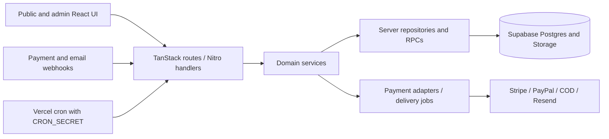

# Architecture

## Runtime and boundaries

HKSCDA is one SSR application, not a separate SPA and API deployment. TanStack
Router discovers `src/routes/`; `src/routeTree.gen.ts` is generated. The Vite
wrapper installs React, Tailwind, TanStack Start and Nitro plugins.
`vite.config.ts` selects Nitro's `vercel` preset and `src/server.ts` wraps SSR
responses with error handling and security headers. Two volunteer POST handlers
are explicitly registered under `server/routes/` in that config; check both route
trees when changing volunteer bulk/task transport.

| Boundary                | Source of truth                                            | Contract to preserve                                                                                                                                              |
| ----------------------- | ---------------------------------------------------------- | ----------------------------------------------------------------------------------------------------------------------------------------------------------------- |
| UI and routes           | `src/routes/`, `src/components/`, `server/routes/`         | Admin UI uses APIs; route files wire transport and dependencies.                                                                                                  |
| HTTP                    | `src/lib/<domain>/http.server.ts`, route handler factories | Validate input, authenticate/authorize, map domain errors to HTTP, bound request bodies.                                                                          |
| Business rules          | `service.ts`, `schemas.ts`, domain-specific modules        | Prefer dependency injection and injectable clocks. Keep pure rules separate from provider/DB access. Existing payment orchestration also lives in server modules. |
| Persistence             | `repository.server.ts`, `supabase/migrations/`             | Transactions and audited mutations use RPCs; application checks do not replace RLS.                                                                               |
| Browser configuration   | `.env.example`, `src/lib/` config modules                  | Every `VITE_*` value is public. Service-role, provider, signing and cron secrets stay server-only.                                                                |
| Delivery and operations | `vercel.json`, domain jobs, runbooks                       | Payment persistence, receipt creation and email delivery have separate outcomes. Retries must preserve idempotency and durable review records.                    |

`*.server.ts` is the server boundary convention. Admin authentication resolves a
bearer token to an active `admin_user` and checks the required roles through
`src/lib/donations/supabase.server.ts`; the UI access matrix is
`src/lib/admin/access.ts`. The service-role client bypasses ordinary RLS, so a
privileged repository cannot substitute for route authorization. Money and PII
also need real role-based database tests.

Every new table needs RLS and intentional grants. Definer functions pin
`search_path`; app-called public RPCs need explicit service-role execution grants.
Admin service-role animal writes must pair the mutation and audit inside an RPC:
the JWT-based animal trigger deliberately skips those writes to avoid duplicate
audit actors. See the enforced rules in `AGENTS.md`.

## Core flows and failure semantics

### Public adoption

`src/routes/api/adoption/applications/photo-upload-urls.ts` issues upload intent
and private photo targets; `applications.ts` validates the saved intent, bearer
token, submission fingerprint and eligible animals before persisting or recovering
the application. The submission service verifies uploaded objects before writing
application details, preferences, status token and intake item, then creates the
coordinator case.

Before case creation starts, persistence failures clean up the application records.
Once case creation starts, its commit may have succeeded even if the response was
lost: preserve the application/token and recover through the retry path.
`resumePublicAdoptionCase` recreates/links the intake item without overwriting an
existing staff-edited item. Intake restoration/link failures are logged while the
recovered case remains usable. A coordinator failure propagates for retry.
Confirmation email is a separate queued/sent/failed result.

### Donations and payment callbacks

`src/lib/donations/service.ts` owns checkout creation with injected repositories
and providers. Signed callbacks enter `src/routes/api/webhooks/{stripe,paypal,cod}.ts`;
`reconcile.server.ts` coordinates event reservation, settlement checks and financial
transitions. A completed browser checkout or an approved PayPal order is not proof
of settlement. Stripe asynchronous checkout credits only a paid session; PayPal
reconciles a completed capture using the order ID or payment metadata fallback.

Duplicate events and uncertain outcomes must preserve the reservation/idempotency
ledger. Full refunds reverse the matching gift/receipt; partial or unmapped
refunds follow provider-specific review handling. PayPal retries when capture
state has not caught up to the refund event. Durable review failure must propagate
so the callback is retried rather than silently acknowledged.

The shared bounded-body reader counts streamed bytes even when `Content-Length`
is missing or understated, cancels overflow and preserves raw webhook text for
signature verification. Public JSON and payment webhook limits are separate.
Receipt/PDF/email work has its own delivery queue and recovery path; a provider
send and a recorded delivery status can fail independently.

### Volunteers, publishing and background work

Volunteer handlers delegate eligibility, capacity, registration, review and bulk
operations to `src/lib/volunteers/`. Hourly jobs use leases and an eligible configured
admin actor before domain work. Sponsorship outbox delivery has its own actor and
lease rules. `vercel.json` declares schedules; job routes require `CRON_SECRET`.
Readiness is separate from executing a job. See
[background jobs](docs/background-jobs-runbook.md) for switch-on and recovery.

CMS authoring and public publication are separate states. Public reads must retain
the saved publication snapshot/pointer when preparing new assets fails. Animal and
content media have repair jobs. Private uploads and public media copies have
different lifecycles; changing one does not authorize publishing or deleting the
other. See [release sequencing](docs/development-release-proposal.md).

## Executable contracts

Tests live beside the source and use `bun:test`. Start with these boundary suites;
the [development guide](docs/development.md#test-tiers) gives runnable commands.

| Contract                                                 | Representative tests                                                                                                                       |
| -------------------------------------------------------- | ------------------------------------------------------------------------------------------------------------------------------------------ |
| Untrusted streamed input and signed payload preservation | `src/lib/http/boundedBody.server.test.ts`                                                                                                  |
| Adoption token/intent, replay and recovery               | `src/routes/api/adoption/applications.test.ts`, `src/lib/publicAdoption/submission.server.test.ts`                                         |
| Payment mapping, settlement, retry and receipts          | `src/routes/api/webhooks/-paypal.test.ts`, `src/lib/donations/reconcile.server.test.ts`, `src/lib/donations/manualAtomic.database.test.ts` |
| Volunteer rules and HTTP authorization                   | `src/lib/volunteers/rules.test.ts`, `src/lib/volunteers/http.test.ts`                                                                      |
| Schema/role boundaries                                   | `src/lib/supabaseMigrations.test.ts`, `supabase/rls-tests/`                                                                                |

Fakes prove orchestration and error contracts. Only an explicitly isolated real
database run proves SQL atomicity, concurrency, grants and RLS. The read-only UI
fixture proves rendering against synthetic data and does not provide Auth,
Storage writes, settlement or email acceptance.

## Short risk map

| Risk                                            | Impact / existing control                                                                                               | Remaining exposure                                                                                                                                                                        |
| ----------------------------------------------- | ----------------------------------------------------------------------------------------------------------------------- | ----------------------------------------------------------------------------------------------------------------------------------------------------------------------------------------- |
| Payment replay or an uncertain provider outcome | Duplicate credit, receipt or capture; event reservations, settlement validation and audited RPCs constrain this.        | Provider sandbox settlement/refund and concurrent SQL tests must pass for the exact release candidate.                                                                                    |
| Privileged API or private-upload leakage        | Donor/applicant PII; role checks, RLS, private buckets and capability tokens protect separate boundaries.               | Service-role code bypasses RLS; fake-client success cannot prove grants or object privacy.                                                                                                |
| Partial adoption/CMS writes                     | Lost intake, orphaned uploads or broken public content; recovery paths and publication snapshots preserve usable state. | Recovery needs real DB/Storage fault scenarios as well as the fast failure-path tests.                                                                                                    |
| Disabled protection or delivery configuration   | Abuse, unsent receipts or unprocessed queues; boot assertions, readiness and guarded jobs expose misconfiguration.      | Missing Turnstile secrets and required rate limiting block production submissions; other limiter callers can fail open. Missing cron/actors stops work. Verify config and backlog status. |
| Recovery and release drift                      | App/schema incompatibility or incomplete restore; migration review and backup/restore runbooks exist.                   | Historical evidence and a data dump do not prove current Auth/Storage/config recoverability or a safe rollback.                                                                           |

## Next three engineering investments

1. **Make isolated database acceptance reproducible from a clean checkout.**
   Consolidate the legacy 553xx, policy 563xx and newer clone/fidelity harnesses
   behind a documented disposable-target command with identity checks and cleanup.
   Graduate `rls-matrix` to a required gate after reliable green runs. Success:
   financial replay, audit rollback and role/Storage denial scenarios run without
   retained workstation credentials or shared fixtures.
2. **Add a small provider-sandbox journey gate.** Cover donation checkout → signed
   settled callback → one gift/receipt → delivery recovery → refund, plus adoption
   upload → submit → retry → staff intake. Use synthetic identities and an email
   sink. Success: exact candidate evidence includes provider outcomes, saved state,
   duplicate delivery and failure recovery, with no real recipients or money.
3. **Turn readiness and recovery into operational evidence.** Alert on job age,
   failed/leased deliveries and manual financial review; rehearse a compatible
   restore including DB, Auth, object bytes and required configuration. Success:
   an owner-approved RPO/RTO, measured restore drill and a release checklist tied
   to a deployment SHA rather than an old report.
